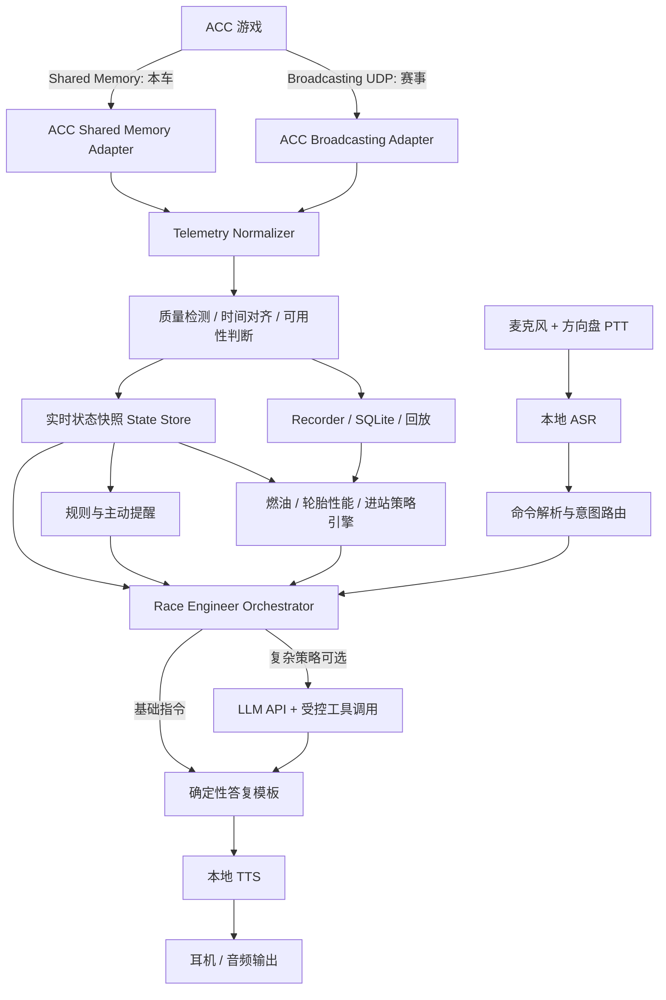

# ACC 智能赛车 TR（Team Radio）系统研究与开发计划书

> **项目定位**：基于 Assetto Corsa Competizione（ACC）实时遥测的本地语音车队无线电与 AI Race Engineer 系统  
> **文档版本**：V1.0（技术预研与实施基线）  
> **编制日期**：2026 年 11 月 3 日  
> **首发平台**：Windows PC（与 ACC 游戏运行于同一台计算机）  
> **首适配游戏**：Assetto Corsa Competizione（PC 版本）  
> **最终形态**：可离线完成基础 TR 查询、可选接入大模型 API 的独立桌面软件  
> **文档性质**：工程研究计划与开发实施方案；并非已经完成的实测报告

---

## 0. 执行摘要与技术决策

本项目拟开发一套不依赖 SimHub 的独立赛车 TR 系统。在 ACC 中，软件读取车辆和比赛的实时状态，允许驾驶者通过方向盘无线电按键发起短语音询问，以低延迟语音播报回答；在此基础上增加燃油估计、轮胎状态趋势、比赛事件提醒、进站窗口优化以及面向策略解释的大模型 API。

**确定的技术路线**：

1. **遥测采集**：自研 ACC 适配器。`Shared Memory` 为本车遥测主数据源，`Broadcasting UDP` 为比赛车辆、车手、赛事状态的补充数据源。两者独立接入，不能把广播接口当作包含完整车辆物理遥测的通用 UDP 接口。
2. **语音交互**：C# 本地采音 + 按键讲话（Push-to-Talk，PTT）+ 本地 ASR + 确定性意图匹配 + 本地 TTS。第一版不训练专用小模型，也不要求联网。
3. **比赛计算**：确定性规则与轻量统计模型负责燃油、状态趋势、进站成本与轮胎方案的计算，关键结果在本地可追溯、可测试。
4. **大模型**：作为可插拔的解释与交互层，通过受控工具调用（Tool Calling）访问结构化状态及已计算的候选策略；不持续接收高频遥测流、不自行杜撰赛况、不替代确定性安全规则。
5. **工程实现**：C# / .NET 为主，WPF 桌面 UI，SQLite 存档与回放；研究阶段允许使用 Python/Jupyter 离线训练和比较策略预测模型，但正式软件不强制安装 Python。
6. **开发顺序**：先证明数据真实且稳定，再实现语音闭环，随后构建比赛策略分析，最后接入 LLM API。保证每一阶段都能独立交付和验收。

### 0.1 三项不可忽视的 ACC 特殊性

**第一，`tyreWear` 不等于可用的实时磨损百分比。** ACC v1.8.12 共享内存结构存在相关字段，但资料标注为 ACC 未使用，不能当作准确的实时轮胎磨损。系统应报告胎温、胎压、轮胎组、轮胎使用时间和基于圈速衰减估计的性能变化；不得在没有观测依据时宣称“轮胎剩余 37%”。

**第二，ACC 轮胎策略不能照搬 F1 游戏的软/中/硬胎模型。** ACC GT 类赛事的首版策略范围是干胎/雨胎、轮胎组（set）、胎压与更换时机，并结合当前比赛的强制进站、车手轮换和天气限制。具体轮胎规格、规则与最佳压力必须针对 ACC 版本、车型、赛事设置验证。

**第三，结构体“存在某字段”不意味着“当前版本写入了有效值”。** 文档中有标记为未使用的字段；部分历史文档还存在单位、字段类型或布局歧义。每一个用于语音播报或策略决策的字段都必须经过实时验证，输出状态采用 `valid / stale / unavailable / estimated` 等显式标记。

### 0.2 项目成功定义

最小可用版本（MVP）应完成一次真实 ACC 驾驶中的完整闭环：

> 驾驶者按住方向盘 TR 按键说“现在胎压怎么样” → 系统从 ACC 读取四轮胎压 → 根据 ACC 版本与用户配置判断是否需要提醒 → 松键后在可接受延迟内播报；无需查看屏幕，无需 SimHub，无需互联网。

策略版本应完成另一条闭环：

> 驾驶者说“什么时候进站比较合适” → 软件先验证比赛规则与数据充分性 → 本地计算若干候选进站方案及不确定性 → 可选调用大模型解释方案 → 播报简短结论；证据不足时明确说“目前样本不足，暂时无法给出可靠进站圈数”。

---

## 1. 研究背景、目标及范围

### 1.1 产品需求背景

赛车模拟器通常提供实时数据，但驾驶者在高速驾驶时读取 HUD、榜单或进站界面会分散注意力。真实赛车的车队工程师通过无线电提供简短、及时且与比赛上下文相关的信息，因此语音 TR 系统的价值不在于“聊天能力”，而在于**减少视线离开赛道的频率、缩短获取数据的操作链条以及提升策略决策的可解释性**。

### 1.2 总体目标

建立具备可扩展能力的独立软件，覆盖四项核心功能：

- **实时获取**：燃油、气温、路温、雨势、轮胎温度/胎压、圈速、排名、相邻车辆、赛道状态、强制进站信息等。
- **语音查询**：有限指令集的低延迟、低误触发、抗比赛音效干扰的本地语音交互。
- **主动提醒**：燃油不足、进站窗口接近、异常温度/胎压、进站规则风险、天气变化等，支持优先级、静默条件与冷却时间。
- **策略与 AI**：根据比赛历史数据与模型输出分析是否进站、何时进站、换干胎还是雨胎、应补多少油；利用大模型把可验证的策略结论组织为自然语言。

### 1.3 本期工作范围

**纳入首期**：ACC PC；只读遥测；本地运行；PTT；中/英文短指令（优先一种语言做好）；干/雨胎判断的研究性原型；历史数据记录与回放；LLM API 接口预留。

**本期不做**：自动替玩家按键操作进站 MFD、主动驾驶/控制车辆、读取未经授权的进程内部内存、修改游戏文件、绕过反作弊或在线赛事规则、多游戏适配、从零训练通用语音大模型。

### 1.4 成功边界与限制

- 无法获取的游戏数据绝不伪造；未标定的预测输出不得伪装成精确实时值。
- 天气“10 分钟/30 分钟预测”只应视为游戏提供的离散预报类别，不是毫秒级确定的降雨时间。
- 用户对策略拥有最终决定权；第一版只提供建议、不自动执行。
- 面向在线比赛时遵守游戏和赛事对于第三方辅助软件的限制；发布与商业化须另行核查许可条件。

---

## 2. ACC 遥测接口现状与可行性

### 2.1 两条官方协议路径

| 维度 | Shared Memory（本机共享内存） | Broadcasting UDP（转播接口） |
|---|---|---|
| 典型用途 | 本车物理、驾驶操作、仪表和比赛状态 | 转播、榜单、场上车辆、车手与圈速事件 |
| 数据来源 | ACC 在本机发布的内存映射区 | ACC 广播协议服务 |
| 主要结构/对象 | Physics / Graphics / Static | `RealtimeUpdate`、`RealtimeCarUpdate`、`CarInfo`、`EntryList`、`LapInfo` 等 |
| 是否需要相同电脑 | 是；若跨电脑需另写本机中继 | 可按配置和网络条件连接 |
| 是否包含精细本车轮胎/燃油 | 包含部分可用字段 | 通常不包含这类精细物理字段 |
| 是否支持对手信息 | 部分位置/ID/差距 | 更适合补充车手、车辆与排行榜 |
| 第一期定位 | **必做、基础依赖** | 建议纳入 ACC 适配 V0.2 |

ACC 的广播 SDK C# 工程可在游戏相关 SDK 文件中找到；Steam 上的 ACC Dedicated Server 文件清单同样公开列出了 `sdk/broadcasting/Sources/ksBroadcastingNetwork` 及 `ACCUdpRemoteClient.cs`、`BroadcastingNetworkProtocol.cs` 等文件。其存在意味着可以基于已发布的接口文档独立实现客户端，不意味着开发商业产品可以不受任何协议限制。参见资料 [S1]–[S4]。

### 2.2 Shared Memory 具体机制

Windows 上常见的 ACC 共享内存名称：

```text
Local\acpmf_physics
Local\acpmf_graphics
Local\acpmf_static
```

三类内存页：

- **Physics**：随游戏物理或图形更新，主要针对玩家车辆；速度、踏板、轮胎核心温度、轮胎压力、制动盘温度、燃油等。
- **Graphics**：比赛/仪表显示状态；圈速、排名、场上车辆位置、赛道状态、雨势及预测、进站设定、剩余时间等。
- **Static**：载入比赛时初始化的相对静态信息；车型、赛道、车辆最大油箱、轮胎名称、进站窗口参数等。

**开发注意**：

1. 用只读方式打开映射内存，绝不将修改共享内存视为合法的“控制游戏”途径。
2. 结构体的字段顺序、数据宽度、字符串 `wchar_t`（Windows 常见 UTF-16）、字节对齐及原始偏移都需要以实际 ACC SDK 版本核对。
3. 采用 `packetId` 检查更新，避免频繁重复处理同一帧。
4. 对多页读取考虑采样瞬间不一致；读取前后可比对更新计数并丢弃明显不一致的快照，保留每页独立时间戳。
5. 不应硬编码假定 Physics、Graphics、Static 始终以同一采样率更新。
6. ACC、传统 Assetto Corsa 和其他游戏可能有相似命名空间，自动识别时应结合游戏进程、协议版本和有效性校验，不能仅按名称判定。

### 2.3 Broadcasting UDP 接入

常见设置文件位置：

```text
%USERPROFILE%\Documents\Assetto Corsa Competizione\Config\broadcasting.json
```

常见可用配置范例：

```json
{
  "updListenerPort": 9000,
  "connectionPassword": "",
  "commandPassword": ""
}
```

这是**技术验证用配置示例**，不是通用强制值。端口、密码必须与客户端匹配；部分第三方示例使用非空连接密码。`updListenerPort` 是现有生态中实际使用的拼写，不能自行纠正为 `udpListenerPort` 后假定游戏一定能识别。实际设置以已安装版本和 SDK 为准。软件应只在用户明确允许时引导配置，不擅自覆盖其他工具已写入的文件，并在修改前备份。

广播客户端应实现：

1. 连接与协议握手、可配置端口及密码；
2. Session/Track 信息读取；
3. Entry List 与驾驶员/车辆标识映射；
4. 各车动态位置、圈数、圈速与赛事事件同步；
5. 断线重连、会话切换、旧对象清理；
6. 与 Shared Memory 的玩家 `playerCarID` 或其他稳定身份信息关联；
7. 与其他软件同时使用广播接口时的端口占用、配置冲突和重连测试。

**不在第一版实现广播指令控制摄像机、回放或游戏菜单。** 这些与只读 TR 目标无关。

### 2.4 数据字段可用性分级

以下是**研发待验证清单**，不是已经在用户机器上实测通过的结果。

| 需求 | 候选原始字段/来源 | 初步判断 | 验证重点 |
|---|---|---|---|
| 当前速度/挡位/转速 | Physics：`speedKmh`、`gear`、`rpm` | 高可行 | 单位、挡位编码 |
| 当前燃油 | Physics：`fuel` | 高可行 | **原始单位必须与游戏 HUD 核对**；文档与二次资料表述并不完全一致 |
| 每圈油耗 | Graphics：`fuelXLap`；历史燃油差分 | 高可行 | 刚进站/开始圈、无效圈和补油场景 |
| 还能跑多少圈 | Graphics：`fuelEstimatedLaps` | 有现成估计 | 与自研估计差异、极短赛程稳定性 |
| 空气/赛道温度 | Physics：`airTemp`、`roadTemp` | 高可行 | 与 HUD 对照、刷新频率 |
| 四轮胎压 | Physics：`wheelPressure[4]` | 高可行 | 轮位顺序、压力单位（一般以 PSI 显示） |
| 四轮胎温 | Physics：`tyreCoreTemperature[4]`、`tyreTemp[4]` | 高可行 | 字段含义重复、温度是否对应核心温度 |
| 轮胎内/中/外三段温度 | `tyreTempI/M/O[4]` | **不可默认使用** | 1.8.12 资料注明 ACC 未提供有效值 |
| 精确实时轮胎磨损 | `tyreWear[4]` | **不作为输入** | 资料指向 ACC 未提供有效实时磨损；实测发现有效值前不得启用 |
| 轮胎组与雨胎状态 | Graphics：`currentTyreSet`、`rainTyres` | 高可行 | 进站前后变化、轮胎组编号含义 |
| 下一轮胎组设置 | Graphics：`mfdTyreSet`、`strategyTyreSet` | 候选可用 | “已选组”不等于“游戏实际执行组” |
| 赛况/当前排名 | Graphics：`position`、`completedLaps` | 高可行 | 不同赛段、重播和多人比赛 |
| 前后车时间差 | Graphics：`gapAhead`、`gapBehind` | 候选可用 | **单位是毫秒，不是距离米**；谁是同圈/不同圈 |
| 其他车辆及车手 | Broadcasting 的 Entry List / Realtime Car Update | 可行 | player ID 与车手名、类别和车队稳定匹配 |
| 会话剩余时间 | Graphics：`sessionTimeLeft` | 高可行 | 单位/计时赛结束与额外一圈逻辑 |
| 强制进站 | Graphics：`missingMandatoryPits`、`mandatoryPitDone` | 有部分字段 | 不同比赛规则、窗口和多次进站 |
| 进站窗口 | Static：`PitWindowStart`、`PitWindowEnd` | 候选可用 | 字段单位、零值语义与赛事设置 |
| 雨量及游戏预测 | Graphics：`rainIntensity`、`rainIntensityIn10min`、`rainIntensityIn30min` | 可用类别信息 | 是否实际刷新；仅为离散等级，不是逐分钟雨量曲线 |
| 路面抓地/湿度等级 | Graphics：`trackGripStatus`、`trackStatus` | 高可行 | 值域映射、天气变化下滞后 |
| 赛道与车 | Static：`track`、`carModel` | 高可行 | 新载入赛段后刷新 |
| 制动温度/寿命 | Physics：`brakeTemp[4]`、`padLife[4]`、`discLife[4]` | 可行 | 单位、车种适用性、解释边界 |
| 当前胎压/加油 MFD 设置 | Graphics：`mfdTyrePressure*`、`mfdFuelToAdd` | 候选可用 | 只读展示，避免误判为已执行操作 |

**工程约束**：所有原始值经过字段适配后必须附带：`source`、`observedAt`、`unit`、`quality`、`gameVersion`、`isEstimated`。关键字段应有独立的实时单元测试与人工对照证据。

### 2.5 容易造成策略错误的地方

**轮胎磨损**：禁用直接引用 `tyreWear` 作为轮胎剩余量的功能。后续可以推断“性能衰减趋势”，但该值是模型估计，不是游戏公布的轮胎物理磨损。

**燃油单位**：`fuel` 的旧版文档转录中出现过 kg 的描述，而常用第三方实现将其作为 liters；这一不一致必须在首周用 ACC HUD、燃油 MFD 与实测单位变化确认。未经核实不得直接把原始值标为“升”。

**“天气预报”边界**：仅把 `rainIntensityIn10min`、`rainIntensityIn30min` 映射为游戏显示的预报等级。不得据此凭空断言“7 分 30 秒后开始下雨”。

**其他车轮胎**：广播通常不提供对手细致轮胎、燃油、磨损。策略引擎不能假定知道对手下一站换什么胎或剩余几升油。

**车辆规则差异**：ACC 的 GT3/GT4/单一车型、单机和多人比赛规则可能不同；先实现规则适配器与可用性检查，再实现完整进站策略。

---

## 3. 需求与功能分层

### 3.1 功能优先级

| 优先级 | 功能 | 输入/依赖 | 预期输出 |
|---|---|---|---|
| P0 | ACC 自动识别与连接 | 本地游戏进程、Shared Memory | 连接状态及错误原因 |
| P0 | 轮胎/燃油/天气查询 | 本车有效遥测 | 数值播报 |
| P0 | 当前排名/圈速查询 | Graphics | 简短排名、圈速 |
| P0 | TR 按钮与本地语音 | 麦克风、按键、ASR/TTS | 按键说话与语音回答 |
| P0 | 无数据安全降级 | 数据有效性状态 | 不播报错误数值 |
| P0 | 数据录制/回放 | 采样器、本地存储 | 不启动游戏即可回归测试 |
| P1 | 对手姓名、相邻差距 | Broadcasting + 身份映射 | 前后车、时间差 |
| P1 | 燃油预测 | 有效整圈耗油样本 | 预计剩余圈数/补油建议 |
| P1 | 主动事件提醒 | 规则引擎 | 简短提醒/避免重复 |
| P1 | 轮胎温度/胎压趋势 | 轮位遥测、车型设置 | 异常趋势与相关风险 |
| P2 | 进站候选窗口 | 燃油、圈速、规则、进站成本 | 若干可比较的进站方案 |
| P2 | 干胎/雨胎切换分析 | 天气预报、路况、历史性能 | 条件式轮胎建议 |
| P2 | 大模型 API | 结构化工具/策略结果 | 解释方案、自然问答 |
| P3 | 多比赛、多车型数据标定 | 长期历史数据 | 个性化性能模型 |
| P3 | 其他赛车游戏 | 新游戏适配器 | 不改上层业务即可扩展 |

### 3.2 基础指令集（第一版）

| 意图 ID | 用户可能的说法 | 应答内容 | 必要字段 |
|---|---|---|---|
| `GET_AIR_TEMP` | 气温多少、现在气温、空气温度 | “气温二十四度。” | `airTemp` |
| `GET_TRACK_TEMP` | 路温多少、赛道温度 | “赛道温度三十二度。” | `roadTemp` |
| `GET_TYRE_TEMP` | 轮胎温度、胎温怎么样 | 优先异常轮位；可问“详细数据” | 4 × 核心温度 |
| `GET_TYRE_PRESSURE` | 胎压多少、胎压怎么样 | 当前四轮压力与偏差提示 | 4 × 压力 |
| `GET_FUEL` | 还剩多少油、油量 | 剩余油量；可选预计圈数 | `fuel`、油耗估计 |
| `GET_POSITION` | 我现在第几、排名 | “目前第五名。” | `position` |
| `GET_LAP_TIME` | 刚才圈速、上一圈多快 | “上一圈一分四十七秒二。” | `iLastTime` |
| `GET_GAP_AHEAD` | 前车差多少、前面是谁 | 对手 + 时间差，不能拿距离米替代 | `gapAhead`、广播映射 |
| `GET_WEATHER` | 下雨吗、天气怎么样 | 当前雨势、赛道抓地、游戏趋势 | `rainIntensity`、`trackGripStatus` |
| `GET_PIT_REQUIREMENTS` | 还要进站吗、进站窗口呢 | 剩余强制进站、窗口状态 | mandatory/pit 字段 |
| `REPEAT_LAST` | 再说一遍 | 重复上一条未过期答案 | 上一次可用回答 |
| `MUTE_RADIO` | 关闭提醒、安静一点 | 仅抑制主动播报，不影响必要的系统状态提示 | 用户配置 |

完整值播报可使用二次提问，如“详细胎温”；默认应答一口气说完且尽量短。所有指令支持同义短语，不要求用户准确背诵固定句子。

### 3.3 主动提醒场景

1. **严重级**：燃油按保守估计不足完赛、强制进站期限将至（前提是有可靠规则与时间信息）。
2. **普通级**：轮胎/胎压持续偏离配置范围、天气从干到湿的趋势变化、进站窗口进入候选范围。
3. **低优先级**：排名变化、个人最快圈、普通圈速变化；默认关闭或低频提醒。

提醒系统应至少具有：同一事件去重、严重程度、全局静默期、每事件冷却、繁忙时排队/丢弃、超时不播报、长句截断。用户主动发问优先于低优先级主动提醒；比赛发车、激烈攻防可优先静默非紧急播报。

---

## 4. 总体架构与数据流

### 4.1 系统逻辑架构



**数据与语音两条链路解耦**：遥测在后台持续处理，语音仅在用户触发或规则事件触发时查询快照。断网、API 额度耗尽或 LLM 故障不得影响 P0 基础查询。

### 4.2 推荐技术栈

| 层 | 初选技术 | 备选方案 | 说明 |
|---|---|---|---|
| 主运行时 | **C# / .NET 10，Windows x64** | 当前稳定 LTS 版本升级策略 | 主程序与各模块统一语言 |
| 桌面 UI | **WPF + MVVM** | WinUI 3 | MVP 优先稳定与工具生态 |
| 本机共享内存 | `MemoryMappedFile` + 显式结构体解析 | Win32 `OpenFileMapping`/`MapViewOfFile` | 只读访问，重点是布局与安全性 |
| 广播协议 | `UdpClient` / `Socket` + 协议解析器 | 适配 SDK C# 示例 | 显式处理连接、身份映射 |
| 异步通道 | `System.Threading.Channels` | 自定义环形缓冲 | 有界队列、最新快照优先 |
| 本地数据库 | **SQLite + WAL** | Parquet（离线分析） | 比赛回放与模型数据 |
| 音频输入/输出 | WASAPI、NAudio 或相应 Windows API | PortAudio | 游戏运行期间后台采音 |
| 本地 ASR | **sherpa-onnx C#** | Vosk | 中文/英文模型及流式识别需测试 |
| VAD | sherpa-onnx 集成 VAD / Silero VAD | 简单能量门限 | PTT 模式下不是阻塞依赖 |
| 指令分类 | 规则、别名与轻量模糊匹配 | 意图分类小模型 | 先测误识别再决定训练 |
| 本地 TTS | sherpa-onnx TTS / 经验证的中文或英文模型 | Windows TTS / 预录语音 | 必须确认选用模型许可证 |
| 策略计算 | C# 统计/优化 | Python 原型对比 | 上线时要求确定性可测试 |
| 大模型 | 自定义可切换 HTTP 客户端 + Tool Calling | 不同服务商 API | 不硬绑定单一 API 提供方 |
| 配置与密钥 | JSON 配置 + Windows Credential Manager/DPAPI | 本地系统安全存储 | API Key 不写进日志或仓库 |
| 测试 | xUnit + 回放文件 + 集成测试 | NUnit | 帧、事件、语音、策略端到端 |

> 技术选型是建议，不是依赖许可证审查结论。第三方库代码、模型权重、声音以及 SDK 示例必须分别核对使用和再分发许可。[S6]

### 4.3 模块分工与接口边界

```text
ACC-TR/
├─ src/
│  ├─ AccTr.App/                    # WPF 主程序、配置、设备绑定
│  ├─ AccTr.Core/                   # 统一数据模型、时钟、错误类型
│  ├─ AccTr.Telemetry.Abstractions/ # IGameAdapter、数据质量接口
│  ├─ AccTr.Telemetry.ACC/
│  │  ├─ SharedMemory/
│  │  ├─ Broadcasting/
│  │  ├─ Mapping/
│  │  └─ AccAdapter.cs
│  ├─ AccTr.Voice/                  # PTT、采音、ASR、意图、TTS
│  ├─ AccTr.Engineer/               # 查询/告警/策略协调器
│  ├─ AccTr.Strategy/               # 燃油/轮胎/天气/进站模型
│  ├─ AccTr.AI/                     # API 客户端与工具调用安全层
│  ├─ AccTr.Storage/                # SQLite、事件、历史与回放
│  └─ AccTr.Diagnostics/            # 指标、日志、性能检查
├─ tests/
│  ├─ AccTr.Protocol.Tests/
│  ├─ AccTr.Core.Tests/
│  ├─ AccTr.Voice.Tests/
│  ├─ AccTr.Strategy.Tests/
│  └─ AccTr.Replay.Tests/
├─ fixtures/                         # 人工构造和获授权的匿名样本
├─ research/                         # Python/Jupyter 算法实验（可选）
├─ docs/
│  ├─ ACC_FIELD_MATRIX.md
│  ├─ TELEMETRY_SCHEMA.md
│  ├─ VOICE_COMMANDS.md
│  ├─ STRATEGY_SPEC.md
│  └─ VALIDATION_REPORT.md
└─ README.md
```

> 统一数据模型要区别“游戏原始数据”和“推断结果”，禁止上层逻辑通过类型转换把估计值误当作测量值。

---

## 5. 遥测内核设计（Telemetry Engine）

### 5.1 原始采集与标准化

定义三种层次：

1. **Raw Snapshot**：保持 ACC 原始字段和原始时间戳，仅负责解码；记录协议布局/版本。
2. **Normalized State**：把数据变成统一轮位顺序、统一单位、标准枚举、稳定 ID 和带状态的测量值。
3. **Derived Metrics**：通过历史数据得到燃油剩余圈数、相邻差距趋势、轮胎性能指数、进站建议等，均附算法版本及置信状态。

统一轮胎顺序始终为：`FL`（左前）、`FR`（右前）、`RL`（左后）、`RR`（右后）。对单位不明的数据保持原始字段并禁用播报，直到完成校准。

**建议数据类型（接口草案，不是已实现代码）**：

```csharp
public enum DataQuality
{
    Valid,
    Estimated,
    Stale,
    Unavailable,
    Invalid
}

public record TelemetryValue<T>(
    T? Value,
    string Unit,
    DateTimeOffset ObservedAt,
    DataQuality Quality,
    string Source
);

public record WheelState(
    TelemetryValue<double> CoreTemperatureC,
    TelemetryValue<double> PressurePsi
);

public record RaceState(
    string GameId,
    string SessionId,
    string? CarModel,
    string? TrackId,
    TelemetryValue<double> Fuel,
    TelemetryValue<double> AirTempC,
    TelemetryValue<double> RoadTempC,
    IReadOnlyList<WheelState> Wheels,
    int? Position,
    int? CompletedLaps
);
```

生产实现需要另外加入源字段版本、单位元数据、会话相位、轮胎组、雨势、对手、规则状态等。这里仅展示 `quality` 约束。

### 5.2 更新节奏与线程模型

| 任务 | 预设目标/策略 | 原因 |
|---|---|---|
| Physics 轮询 | 20–50 Hz（可配置，上限由设备测试决定） | 满足温度/胎压趋势；不追求复制物理引擎采样频率 |
| Graphics 轮询 | 5–20 Hz，按更新计数实际生效 | 赛事 HUD 等无须满速读取 |
| Static 读取 | 连接/会话切换时刷新 | 避免无效频繁读取 |
| 广播处理 | 按推送事件处理 | 避免伪造实时高频采样 |
| UI 状态刷新 | 5–10 Hz | 后台工具不需要大量重绘 |
| 语音查询 | 取最新有效快照 | 只要用户需要，不等待下一整圈 |
| 常规日志 | 5–10 Hz + 关键事件 | 减少磁盘写入、保留策略所需信息 |
| 研究用高精度录制 | 20–50 Hz，可配置 | 只用于专项建模、可按需启用 |

所有频率为**待验证工程目标**。优先保证 ACC 帧率和语音响应，不应要求系统始终最大频率采集。

建议采用一个生产者、多订阅者的有界通道。实时 UI 和语音路径只保留最新状态；录制路径采取批量写入或独立队列，明确溢出时的丢弃策略。避免缓慢磁盘写入阻塞采集线程。

### 5.3 会话状态机

```text
DISCONNECTED
    ↓ 发现 ACC 与有效映射
CONNECTING
    ↓ 解码校验通过
CONNECTED_IDLE
    ↓ 进入比赛 LIVE
SESSION_ACTIVE
    ↙          ↓           ↘
 PAUSED    PIT_SEQUENCE   SESSION_END
    ↘          ↓           ↙
             RESET
                ↓
         CONNECTED_IDLE
```

状态机需要处理：进入游戏、载入赛道、暂停、重播、退回主菜单、换车、换服务器、强制退出、游戏崩溃、网络中断、比赛结束、场上车辆退出或重新加入。每次状态切换都要使失效的数据过期，而不是保留旧成绩当作新会话内容。

### 5.4 录制与回放

至少保存：

- `sessions`：时间、游戏版本、车型、赛道、规则、采样配置；
- `telemetry_samples`：状态快照及采集质量；
- `lap_records`：整圈/有效圈/异常圈、圈速、燃油变化；
- `race_events`：进站、换胎、排名变化、天气变化、告警；
- `strategy_runs`：输入摘要、候选策略、模型版本、结论及置信状态；
- `voice_events`：匿名指令 ID、ASR 处理时间和结果（原始音频默认不保存）。

回放播放器应能够重现相同的状态事件序列，并从中触发相同的规则或策略计算。采用单调时钟和相对比赛时间，避免系统墙上时间变化影响判断。

数据保留建议：默认本地 30 天，可配置；敏感日志用户主动开启。API 仅发送最小必要比赛数据，禁止默认上传原始完整录制或他人身份信息。

---

## 6. 本地语音系统（Voice Engine）

### 6.1 技术选择：PTT + 本地 ASR + 规则匹配 + TTS

选择 **sherpa-onnx（C# API）** 作为首要候选，Vosk 作为备选，通过统一接口进行 A/B 测试。sherpa-onnx 提供 C# 流式/非流式 ASR 示例，并支持本地 TTS/VAD；必须选取明确支持目标语言、许可可接受且在目标 CPU/GPU 上性能合格的具体模型。参见 [S6]。

第一版不接入实时语音大模型。理由：大多数查询只有明确意图，数据由游戏提供，接入 LLM 对识别“气温多少”本身收益有限，却引入成本、网络、等待与幻觉风险。

### 6.2 交互机制

**默认模式：方向盘 PTT。** 读取方向盘/手柄按钮，或允许映射键盘快捷键。不同品牌方向盘的 HID/DirectInput/XInput 支持情况需实测，不能假设所有设备均被 XInput 识别。按下开始采集，松开后确认语音；可配置最短录音长度与超时。

**备选模式：按键切换录音**、后期“始终监听 + VAD/唤醒词”。第一版不必让系统持续监听，以降低背景声误唤醒。

支持：

- 输入麦克风和输出耳机选择；
- 识别语言与工程师播报语言独立设置；
- 增益与噪声环境测试；
- 录音时监听提示音（可关闭）；
- 用户讲话时打断正在播放的常规播报；
- 播报音量相对于游戏音效的独立控制；
- 无语音、低置信识别、无效数据的明确降级。

### 6.3 意图路由规则

建议分三步：

1. **标准化**：去除标点和多余停顿词、同义词映射，例如“胎压 / 轮胎气压”。
2. **确定性意图命中**：精确短语、正则模板、受限模糊匹配；同时设置误识别拒绝阈值。
3. **工具执行**：调用 `GetTelemetry(metric)` 或 `GetRaceStatus()`，由查询模块验证数据质量后生成固定应答模板。

策略类请求（例如“下一站什么时候进”）进入独立策略路由，而不是用模糊匹配直接生成一个数字。

### 6.4 TTS 实现

两个候选：

- **本地神经 TTS**：自然度较好，可灵活生成不同数值、车手和赛道名称；需要测量合成首帧延迟、模型包体积和语言质量。
- **预录固定语句 + 数值播报**：音色稳定、响应迅速、适合高频短指令；可用分句组合改善数字拼接生硬问题。

先建立统一 `ISpeechSynthesizer` 接口，避免正式软件与单一 TTS 实现耦合。长策略解释可以选择神经 TTS；常见 TR 句子可以缓存语音。

### 6.5 语音端到端延迟预算

**指标定义**：用户说话结束（或 PTT 松开）到耳机开始播放有效回答的时间。与“从用户开始讲话到播放”必须区分。

| 环节 | 初步工程目标（非实测） |
|---|---:|
| PTT 终止与 ASR 定稿 | 80–220 ms |
| 意图匹配 | < 10 ms |
| 快照获取与应答格式化 | < 20 ms |
| TTS 首帧/缓存命中 | 80–250 ms |
| 音频缓冲与播放启动 | 20–60 ms |
| **基础 TR 目标** | **p50 ≤ 500 ms；p95 ≤ 900 ms** |

表中是预算，不是供应商承诺；具体结果必须在游戏运行、音效开启和目标设备负载下测量。复杂 LLM 解释另设网络延迟指标，并允许先播报本地确定性摘要，随后补充非紧急解释。

### 6.6 语音验收数据集

录制或征集经授权的有限指令语音：

- 不少于 20 个核心意图、每个意图至少 10 种表达；
- 不少于 5 位说话者（允许先由开发者内部样本快速验证）；
- 考虑中文、英文口音和赛车术语；
- 背景：安静房间、ACC 发动机音效、语音聊天、不同耳机麦克风；
- 额外收集“不应触发”的闲聊/游戏音效样本，避免只测正样本。

评价指标：意图识别准确率、误触发率、拒识率、p50/p95 响应延迟、不同音量下的稳定性。原始音频不默认采集或上传。

---

## 7. Race Engineer：规则、燃油和进站策略研究

### 7.1 研究原则

**策略计算是一个数据建模与优化问题，不是单纯文字生成问题。** 大模型可以解释策略、发起工具调用和回答后续追问，但推荐进站时机应由本地可复现的模型或优化器计算，并明确输入数据、预测假设与不确定性。

研究分为三个能力等级：

- **L0：状态显示与规则检查**。能可靠回答数据与合法性，不进行策略推断。
- **L1：燃油与简单进站可行性估计**。根据历史油耗、比赛剩余时间、强制进站等输出可执行方案。
- **L2：轮胎性能/天气/交通联合策略**。对候选进站时点与干/雨胎方案进行场景模拟与误差评估。

首期计划交付 L0 + L1，并建立 L2 实验原型。不要把尚未标定的 L2 原型包装成完全可靠的车队工程师。

### 7.2 数据预处理与圈级特征

每完成一圈提取：

- 车型、赛道、天气、抓地状态、会话与比赛阶段；
- 圈速及各赛段用时、有效/无效圈、比赛交通情况；
- 圈开始与结束燃油、油耗（排除加油、进站和断档）；
- 胎龄（同一套胎使用圈数/时间）、胎压/胎温统计、降雨状态；
- 轮胎组变化、进站进入/退出时间、坑道损失与服务时间；
- 相邻车辆差距和车流密度特征（若广播数据有效）。

**过滤规则**：不将出站圈、进站圈、明显失误、黄旗干扰、车辆损坏明显突变或遥测缺失严重的圈直接当作正常轮胎衰减样本。建立可追溯的样本剔除原因，避免模型学到错误趋势。

### 7.3 燃油预测模型（优先实现）

使用最近 `n` 个有效完整圈的稳健统计：

$$
\hat f_{\mathrm{lap}}=\operatorname{median}(f_1,\ldots,f_n),
$$

其中 $f_i$ 是第 $i$ 个有效圈实际消耗的燃油（必须统一单位）；为应对油耗随驾驶风格变化，可用指数加权平均或分条件回归作为第二基线。

预估还能完成的完整圈数：

$$
\hat N_{\mathrm{fuel}}=\frac{F_{\mathrm{remaining}}-F_{\mathrm{reserve}}}{\hat f_{\mathrm{lap}}}.
$$

计划需要的补油量：

$$
F_{\mathrm{add}}=\max\left(0,\hat N_{\mathrm{required}}\hat f_{\mathrm{lap}}+F_{\mathrm{reserve}}-F_{\mathrm{remaining}}\right).
$$

**关键约束**：

1. `sessionTimeLeft` 为计时比赛时，剩余圈数要由剩余时间、预测圈速、比赛结束判定及可能的额外一圈共同估计；不能简单除法向下取整。
2. 预测不足样本时，应使用游戏提供的 `fuelEstimatedLaps` 作为可对比的参考值，但不能把它当作无误差真值。
3. 需检测加油行为并重置/分割燃油序列。
4. 应提供保守边界（例如按油耗上分位数算）而不是只报告平均值。
5. 涉及补油量的建议必须先通过单位校验、油箱容量与比赛规则检查。

### 7.4 轮胎性能衰减研究（替代不可用的实时磨损量）

由于 ACC 不应依赖未提供的实时磨损值，研究目标改为估计**当前轮胎带来的圈速损失**，而非橡胶物理剩余百分比。

初始模型：

$$
T_{i}=\alpha_{c,s}+\beta_1 A_i+\beta_2 A_i^2
+\gamma_1 F_i+\gamma_2 \Theta_i
+\gamma_3 W_i+\gamma_4 C_i+\epsilon_i,
$$

其中：

- $T_i$：第 $i$ 圈的圈速；
- $A_i$：当前轮胎使用圈数或时间；
- $F_i$：燃油负载代理量；
- $\Theta_i$：温度相关变量；
- $W_i$：天气/路面状态；
- $C_i$：交通或干扰变量；
- $\alpha_{c,s}$：特定车型与赛道条件的基准圈速；
- $\epsilon_i$：未观测影响。

**建模步骤**：

1. 从有效干净圈建立简单线性/二次回归基线。
2. 用滑动窗口和稳健回归抑制驾驶失误。
3. 按车型、赛道、轮胎类型分别建模，避免跨条件误差。
4. 与“只使用最近 N 圈平均圈速”的简单基线比较，不能因复杂模型看起来高级就直接采用。
5. 输出 `estimated_pace_loss_sec_per_lap` 与预测区间，不输出“磨损 XX%”。
6. 如果正常样本量不足或雨势突变，降低可信度或不提供衰减建议。

**局限说明**：同一车手驾驶能力、赛道温度、交通与燃油重量也会影响圈速；圈速变慢不等价于轮胎磨损。该模型用于运营策略参考，不能声称识别真实物理磨损因果机制。

### 7.5 进站窗口与候选策略优化

把一个方案表示为：

$$
S=(L_{\mathrm{pit}},\,Q_{\mathrm{tyre}},\,S_{\mathrm{tyreset}},\,F_{\mathrm{add}}),
$$

其中：

- $L_{\mathrm{pit}}$：计划进站圈或时间；
- $Q_{\mathrm{tyre}}\in\{\mathrm{Dry},\mathrm{Wet}\}$：干胎/雨胎类型；
- $S_{\mathrm{tyreset}}$：所选轮胎组（在规则和可用库存允许时）；
- $F_{\mathrm{add}}$：补油量。

计时赛更适合把进站时间 $t_{\mathrm{pit}}$ 作为连续变量，再映射到可执行的整圈入口。

目标函数的一种初步形式：

$$
\min_S\;\mathbb{E}\left[
T_{\mathrm{remaining}}(S,\omega)
\right]
+\lambda\operatorname{Risk}(S),
$$

其中 $\omega$ 表示天气、赛道交通、圈速变化等不确定场景；不是所有场景都有足够数据进行可靠估计。

总用时可分解为：

$$
T_{\mathrm{remaining}}(S,\omega)=
\sum_{i=1}^{N} \hat T_{\mathrm{lap},i}(S,\omega)
+T_{\mathrm{pitloss}}(S)
+T_{\mathrm{traffic}}(S,\omega)
+T_{\mathrm{penalty}}(S).
$$

**必须在候选策略生成前检查约束**：

- 比赛是否允许或要求进站；
- 进站窗口是否开放以及最低进站次数；
- 是否有车手连续驾驶时长、最大驾驶时间或换人要求；
- 强制换胎/轮胎组/服务限制；
- 油箱容量和预计补油量；
- 不同比赛与服务器规则的适用性；
- 是否已处于进站操作或比赛结束状态。

若关键规则不可读取，不应该自动宣称策略合法；可让用户配置规则，并把策略标记为“按用户输入条件计算”。

### 7.6 干胎/雨胎决策

ACC 初版不设计软/中/硬胎的三选一算法。重点研究以下决策：

- 继续使用当前干胎；
- 下一次进站换新干胎组；
- 进站换雨胎；
- 如果现正使用雨胎，判断是否适合改回干胎。

候选输入：当前 `rainIntensity`、10/30 分钟离散预报、`trackGripStatus`、路温、圈速差、计划剩余时间、轮胎状态、可实测的换胎时间成本。

采用**情景分析**而非伪精确天气预测：

- 场景 A：降雨保持当前等级；
- 场景 B：雨势在 10 分钟附近加剧；
- 场景 C：天气缓和、路面逐步变干。

先通过经验规则建立干/雨胎选择基线，再结合历史实测的干胎与雨胎圈速差改进。若不存在可比样本，则只输出条件式提醒：例如“游戏预报雨势将增强，建议继续观察；当前数据不足以确认换雨胎会更快”。

### 7.7 对手与车流预测

- 利用广播的赛道位置、差距、圈速趋势和车辆是否进站，估计在某一进站时点出站后可能落入的车流。
- 不推断未公开的对手燃油和轮胎真实磨损。
- 避免凭单帧时间差直接估算 20 秒后的精确相对位置；先计算简单的出站名次区间或交通风险等级。
- 处理被套圈车辆、不同组别、车辆退出、掉线与罚时情况。

### 7.8 不确定性、决策阈值与拒绝输出

任何策略结果包含：

```json
{
  "status": "estimated",
  "recommendation": {
    "pitLap": 18,
    "tyreType": "wet",
    "fuelToAdd": null
  },
  "confidence": "low",
  "alternatives": [],
  "assumptions": ["示例：未来降雨将持续"],
  "missingData": ["fuel_unit_unverified"],
  "requiresValidation": true
}
```

这是**数据结构示例，不是实际 ACC 策略计算结果**。若 `fuel_unit_unverified` 仍存在，计算模块应拒绝产生具体补油量，而非拿 `null` 填充后仍播报为完整建议。

优先采用以下保守逻辑：

- 少于最小有效圈数 → 不给精确衰减曲线；
- 车种/赛道/雨胎历史样本不足 → 不给精确轮胎优势秒数；
- 候选策略预期差距小于模型误差 → 报告“方案差距不足以分辨”；
- 对游戏规则或数据单位有疑问 → 禁止自动确认进站合法性与补油量；
- 发现数据断流 → 停止自动建议，保留最后有效结果供事后分析。

---

## 8. 大模型 API 集成研究

### 8.1 API 定位

大模型负责：

1. 理解有限规则匹配覆盖不了的自然语言策略请求；
2. 根据受控工具返回值组织简短、自然的赛道无线电回答；
3. 解释推荐方案依据、假设与风险；
4. 回答“为什么”“与另一方案相比如何”等追问。

大模型**不负责**：实时获取原始游戏内存、编造不存在的变量、在没有数据时给出确定性换胎建议、自动控制游戏、替代赛事规则校验。

### 8.2 Tool Calling 接口设计

| 工具名（草案） | 作用 | 输入要求 |
|---|---|---|
| `get_live_state` | 获取最新经过质量校验的车辆/天气状态 | 选择字段范围 |
| `get_session_rules` | 当前比赛允许的进站与强制服务条件 | 会话标识 |
| `get_tyre_summary` | 最近轮胎温度/胎压/性能估计 | 时间范围和组号 |
| `get_fuel_projection` | 完赛燃油需求和区间 | 目标剩余圈数或时间 |
| `compare_pit_strategies` | 比较候选换胎/补油/时点 | 模型参数和约束 |
| `get_opponent_context` | 车流、排名、相邻对手 | 数量上限 |

API 返回结果应为有版本号的结构化 JSON，并标明 `measurement` 与 `estimate`。模型最终输出再交给本地**事实校验器**，检查轮胎类型、圈数范围、油量、天气描述和有效性。如果模型回答与工具结果冲突，应舍弃模型的具体数值或回退至模板回答。

### 8.3 API 调用触发原则

- `GET_AIR_TEMP`、`GET_FUEL`、`GET_POSITION`、`GET_TYRE_PRESSURE`：永远优先本地，不因配置了 LLM 就绕远路。
- `GET_PIT_STRATEGY`、`WHY_THIS_STRATEGY`、`COMPARE_ALTERNATIVES`：可调用 LLM，但本地策略引擎必须先提供可验证结果。
- 对策略影响重大的天气或进站变化：可由本地规则主动提醒；复杂解释在驾驶负载允许时或用户主动发问时提供。

### 8.4 上下文与成本控制

每次仅发送**当前快照摘要 + 最近若干圈统计 + 已计算候选策略 + 规则约束**，而不是完整高频数据。设置可配置 API 供应商、请求超时、token 预算、最大工具调用次数、重试次数与缓存。

建议不保存完整聊天上下文为默认行为；会话级摘要在比赛结束后可清理。API Key 保存在操作系统安全存储；日志脱敏。云端开关必须明确，脱机时可继续使用全部基础 TR 查询。

### 8.5 大模型验证方法

构建固定 JSON 测试情景至少 30 个，包括：

- 数据充分、合法进站；
- 强制进站窗口关闭；
- 燃油单位未确认；
- 雨势逐渐增大；
- 当前已有雨胎；
- 对手油量未知；
- 轮胎衰减模型数据不足；
- 游戏断线但 API 正常。

测量：工具调用成功率、无依据数值的出现次数、策略规则违规率、回答长度、延迟和平均成本。任何含关键未验证字段的建议必须通过“不给出具体确定值”的测试。

---

## 9. 数据验证与实验设计

### 9.1 研究问题（Research Questions）

- **RQ1**：ACC 的 Shared Memory 与 Broadcasting UDP 能否稳定、低开销地提供语音 TR 所需的有效实时状态？
- **RQ2**：受限意图的本地语音识别在驾驶噪声下是否可达到可接受的准确率和响应延迟？
- **RQ3**：在无法获取 ACC 可靠实时轮胎磨损的前提下，是否能通过圈速、胎压、胎温和条件变量构造有用的轮胎性能衰减估计？
- **RQ4**：基于确定性策略引擎和天气情景模拟，是否比简单固定圈数进站策略提供更好的预计比赛用时及更低的燃油/规则风险？
- **RQ5**：大模型加入后是否能提高复杂问答的可理解性，而不降低事实一致性和实时基础功能的可靠性？

### 9.2 ACC 测试环境

首轮建议两种车型/两条赛道（具体内容按用户已拥有的游戏车辆和赛道选取）。示例：

| 维度 | 基准组 A | 变化组 B |
|---|---|---|
| 车型 | BMW M4 GT3 | 另一辆 GT3 |
| 赛道 | Monza | Spa-Francorchamps |
| 环境 | 干燥、稳定 | 降雨变化 |
| 比赛 | 练习赛、短计时赛 | 中等时长比赛 |
| 人员 | 单人 | 多人/AI 对手 |
| 数据 | 录制原始/标准化快照 | 录制加油、轮胎变化、天气事件 |

**注意**：表格为实验配置建议，不代表已在本机执行。涉及在线数据应遵守比赛规则并尊重他人隐私。

### 9.3 数据采集实验 E1：协议与字段正确性

**方法**：

1. 检查已安装 ACC 游戏版本、SDK 和共享内存布局文档；
2. 打印原始 Physics、Graphics、Static 中白名单字段；
3. 在静止、出站、单圈、进站、天气变化时分别采样；
4. 与 ACC HUD/MFD 人工同步比对，必要时录制合法的本地屏幕视频供对齐；
5. 给每个字段记录类型、单位、更新频率、是否为零占位、可用条件及证据；
6. 对单位不一致或异常字段标记 `NeedsVerification`，禁止进入策略引擎。

**结果**：《ACC_FIELD_MATRIX.md》+ 一份可复现的字段测试脚本/日志 + 至少一次进站前后数据核对。

### 9.4 数据采集实验 E2：稳定性与性能

**方法**：分别在练习赛、在线比赛/与 AI 对赛、暂停与切场景下进行不少于 30 分钟的连续采集；并在多次重启游戏后重新连接。

评价：快照有效率、`packetId` 中断数、错误字段次数、重新连接耗时、CPU/内存/磁盘负载、ACC 游戏帧率变化。记录 P50/P95/P99，而不是只测平均性能。

### 9.5 语音实验 E3：噪声与准确率

在相同语句库下比较 sherpa-onnx 与备选 ASR：

- 安静环境与赛车引擎高音量环境；
- PTT 与持续监听（后者仅作为研究对比）；
- 中文/英文不同模型；
- 常用短问句与否定/相似指令；
- 有无其他玩家语音的混音环境。

**主要指标**：意图正确率、误触发率、拒绝错误率、端到端播报延迟、TTS 自我触发概率。模型选型以真实误差和性能为准，不预先假定某套模型一定最优。

### 9.6 策略实验 E4：燃油预测

设置 15、30、45 分钟不同比赛长度，改变驾驶风格和天气，对比：

- 游戏 `fuelEstimatedLaps`；
- 最近 N 圈均值；
- 最近 N 圈中位数；
- 指数加权与带保守区间的估计。

采用已完成圈的油耗真值，计算 MAE、P90 绝对误差、完赛剩油量及燃油不足的误判/漏判情况。不能用未来圈数据训练后又在同一圈上评估。

### 9.7 策略实验 E5：轮胎衰减及进站决策

对同一车型/赛道配置完成多次可比 Stint，并记录轮胎组、圈速及环境变化。按训练场次/测试场次划分，而不是随机拆分同一场的相邻圈，以减少数据泄漏。

比较：

- 基线 B0：固定进站圈数；
- 基线 B1：最近圈速平均与固定燃油阈值；
- 模型 M1：燃油预测 + 规则检查；
- 模型 M2：M1 + 轮胎性能衰减 + 进站损失；
- 模型 M3：M2 + 天气/交通情景分析（需足够样本）。

评估：预测误差、赛后反事实近似时间收益、错误建议率、禁用建议比例、策略解释与数据的一致性。由于无法在同一真实比赛中同时执行两个反事实方案，必须明确区分**回放模拟结果**与**实际多次对照驾驶结果**，不把模型预测的节省秒数当成已实现的真实收益。

### 9.8 可视化与分析产出

研究阶段建议生成：

- 轮胎核心温度/胎压随时间曲线；
- 每圈油耗的滚动分布及剩余圈数区间；
- 胎龄与校正圈速/残差的关系；
- 不同进站圈数对应的预计完赛时间与不确定区间；
- 干胎/雨胎在不同降雨场景下的优劣；
- 语音识别混淆矩阵与 E2E 延迟分布；
- CPU 负载与 ACC 帧率影响。

以上图表用于研究和调试，最终产品默认不要求驾驶时查看屏幕。

---

## 10. 研发排期、里程碑和交付物

### 10.1 总体周期

以**12 周工作计划**作为个人开发的初步估算；不构成保证完成时间。若同时开展学业/工作，按实际投入调整。优先完成可运行 MVP，再扩展策略，不让 LLM 拖慢底层。

| 周期 | 阶段 | 主要任务 | 验收门槛 |
|---|---|---|---|
| 第 1 周 | P0 技术摸底 | ACC SDK 核查、共享内存读取、单位对照、字段矩阵 | 核心字段已对照 HUD；不存在未验证单位的数值播报 |
| 第 2 周 | P0 遥测内核 | 统一快照、会话状态机、质量判断、日志与回放 | 可连续读取 30 分钟，能应对场景切换 |
| 第 3 周 | P0 Broadcasting | 配置/握手、车辆/车手 ID、榜单和相邻车映射 | 可在一场比赛里正确映射本车与相邻车辆 |
| 第 4 周 | P0 语音原型 | 方向盘按钮、ASR 基线、意图路由、基础 TTS | 典型指令在 ACC 游戏内完成真实语音闭环 |
| 第 5 周 | P0 可用性 | 设备设置、异常降级、误触发与延迟优化 | MVP 验收测试达标 |
| 第 6 周 | P1 比赛规则 | 告警调度、强制进站检查、状态事件 | 主动播报可限频、不误报已失效状态 |
| 第 7 周 | P1 燃油预测 | 完整圈清洗、油耗估计和剩油报警 | 与游戏和测试真值完成对照 |
| 第 8 周 | P1 轮胎趋势 | 胎温/胎压趋势、使用时长、圈速衰减研究 | 能解释局限；不用无效 `tyreWear` |
| 第 9 周 | P2 进站模型 | 进站损失、候选窗口、换胎/补油约束 | 候选方案可复现、合法性可检查 |
| 第 10 周 | P2 天气策略 | 干/雨胎条件判断、情景模拟、拒绝规则 | 极端/缺样本场景能正确降级 |
| 第 11 周 | P2 LLM 集成 | Provider 接口、工具调用、事实校验与成本控制 | 云端不可用时基础功能不受影响 |
| 第 12 周 | 发布候选 | 全链路回归、安装包、文档、测试报告 | 满足验收清单、核心已知问题记录完整 |

### 10.2 阶段性门槛（Go / No-Go）

- **G0（第 1 周末）**：至少完成 10 个高优先级字段的正确性验证；燃油单位明确；无法读取精细轮胎磨损的问题被文档化。若失败，暂停语音开发，先修复数据基础。
- **G1（第 3 周末）**：Shared Memory 与 Broadcasting 至少能独立工作，完整的断线/切场景逻辑通过测试。若广播有兼容问题，MVP 可暂不依赖对手姓名功能。
- **G2（第 5 周末）**：实现稳定的 PTT → 查询 → 本地播报；关闭网络仍可使用。
- **G3（第 8 周末）**：燃油模型达到最低准确度，轮胎模型至少能产生可验证的趋势而非虚假磨损数字。
- **G4（第 10 周末）**：候选策略具备规则约束、数据不足拒答、误差显示和回放测试。
- **G5（第 12 周末）**：LLM 接入不改变本地策略真值来源；所有用户可见数值可追踪来源。

### 10.3 版本建议

**V0.1 — ACC Telemetry Prototype**：共享内存解析、实时字段展示、CSV/SQLite 录制。

**V0.2 — Offline TR MVP**：广播补充、PTT、20 个意图、本地 TTS、告警与回放。

**V0.3 — Race Engineer Basic**：燃油预测、比赛规则与轮胎趋势、保守的进站判断。

**V0.4 — Strategy Preview**：进站候选、干/雨胎情景比较、预测区间。

**V0.5 — AI Race Engineer**：LLM API、Tool Calling、受控策略解释、复杂问答。

**V1.0** 以准确性、稳定性、设置流程和用户测试为发布条件，不以功能数量为发布条件。

---

## 11. 质量指标与验收标准

这些是**拟采用的开发指标**，尚未经过实际性能验证。完成首轮实验后可按硬件和游戏负载调整。

| 类别 | MVP 建议指标 | 评价方式 |
|---|---|---|
| 数据正确性 | 所有 P0 数值字段有 HUD/MFD 对照记录，单位校验完成 | 字段矩阵及回放样例 |
| 数据连续性 | 30 分钟正常游戏期间有效快照比例 ≥ 99.5% | 连续采集日志；排除正常加载与暂停并单独统计 |
| 异常处理 | 游戏退出、重连、切会话不导致程序崩溃或播报旧值 | 自动与人工故障注入 |
| 基础意图准确率 | 受控噪声测试 ≥ 95%；实际赛车音效测试 ≥ 90% | 已标注意图测试集 |
| 基础 TR 延迟 | P50 ≤ 500 ms；P95 ≤ 900 ms | PTT 结束至开始播放的统一计时 |
| 系统占用 | 不造成明显可感知帧率下降；测量具体 CPU/内存开销 | ACC 帧时间对照测试 |
| 主动告警 | 同一事件不频繁重复、可关闭非重要播报 | 场景回放和用户设置测试 |
| 燃油估计 | 以基线模型为参照，要求误差与风险可测量并不断改进 | 按场次留出测试；MAE/P90 |
| 进站策略 | 无已知规则违规建议；缺数据时明确拒答 | 场景与边界测试 |
| AI 可靠性 | 关键数字和结论可对应本地工具输出；断网不影响 P0 | 回归用例与拒答测试 |
| 用户控制 | PTT 绑定、音频设备选择、声音开关、云端开关均有效 | 完整操作测试 |

对预测类指标不应在没有实测基线时设定任意“准确率 99%”之类的目标。验收首先要求**可比较、可解释、具备合理误差上界和拒绝机制**。

---

## 12. 关键技术风险与应对措施

| 风险 | 影响 | 应对方案 | 优先级 |
|---|---|---|---|
| ACC 共享内存布局随版本变化 | 数值错位、错误播报 | 按游戏版本验证结构体布局，提供兼容性检查和回归样本 | 极高 |
| 原始数据单位歧义 | 燃油/策略计算严重错误 | 字段使用前与 HUD 比对；单位不明时阻止计算 | 极高 |
| 轮胎磨损数据不可用 | 无法直接判断胎耗剩余 | 改为胎温/胎压与性能衰减估计；明确置信等级 | 极高 |
| Broadcasting 连接和端口冲突 | 对手信息缺失 | 配置可检查、连接状态可见、错误时退化为单通道 | 高 |
| 用户语音被引擎或其他人声干扰 | TR 误触发、错答 | 优先 PTT；噪声测试、拒绝阈值和回放 | 高 |
| 游戏 CPU/GPU 资源竞争 | 游戏掉帧 | 有界队列、低频轮询、预加载 ASR/TTS、后台低优先级 | 高 |
| 策略训练样本不足 | 决策不可靠 | 简单模型优先、交叉会话验证、不能预测时拒答 | 高 |
| 云端 API 超时或回答幻觉 | 延迟、错误建议 | 本地工具数据来源、事实校验、超时回退 | 高 |
| 服务器比赛规则复杂 | 非法进站建议 | 规则适配器，未知时保守降级 | 高 |
| 多品牌方向盘按键兼容性 | 无法方便讲话 | 通用键盘热键保底、设备绑定测试 | 中 |
| 语音模型许可证不适合分发 | 发布受阻 | 逐项核查模型、代码和音频权利；可替换实现 | 高 |
| 隐私与 API 密钥泄漏 | 用户安全风险 | 最小上传、脱敏、系统安全存储和清理功能 | 高 |
| 线上赛事/软件许可限制 | 产品发布或使用受限 | 发布前检查游戏 SDK、EULA 与赛事规则 | 高 |

---

## 13. 资源、工作量与成本估算

### 13.1 人员与工具

- 主要开发者：1 人，能够完成 C#、数据处理与桌面 UI；研究阶段可辅助使用 Python。
- 基础环境：Windows 计算机、ACC PC 版本、一套方向盘（可先用键盘模拟 PTT）、耳机/麦克风。
- 开发工具：Visual Studio / Rider / VS Code、.NET SDK、Git、SQLite 工具、音频录制与性能分析器。
- 可选辅助：Jupyter/Matplotlib 等用于策略离线验证。

### 13.2 费用分类

| 费用 | MVP | LLM 版本 |
|---|---|---|
| 游戏与测试硬件 | 依用户已拥有资源 | 不新增硬性要求 |
| 本地 ASR/TTS 推理 | 可离线，主要成本为本机算力 | 仍保持本地 |
| 云端 API | 0 | 按请求/Token 计费，设置预算和限额 |
| 数据存储 | 本地 SQLite | 默认不新增云存储 |
| Windows 签名/软件分发 | 开发原型可不签名；发布前评估 | 同左 |
| 许可审核 | 需要 | 增加 API/模型许可审核 |

**目前不提供虚构的 API 单价或硬件耗时。** 在选定供应商、模型和目标电脑后再实测，并形成成本核算表。

---

## 14. 开发启动前的检查清单

### 14.1 协议验证（必须先完成）

- [ ] 已确认 PC 安装的 ACC 游戏版本；
- [ ] 找到当前可用的 ACC Shared Memory v1.8.12 资料及本地 SDK/相关示例；
- [ ] 已确认三个共享内存区域能被只读打开；
- [ ] 已对照游戏 HUD 校准胎温、胎压、气温、路温、速度、排名；
- [ ] 已人工对照确定 `fuel` 的实际单位；
- [ ] 已验证 `tyreWear` 不作为实际磨损量输出；
- [ ] 已校验 `rainIntensity`、`trackGripStatus` 对应的枚举含义；
- [ ] 已完成暂停/换图/重启后旧数据失效处理；
- [ ] 已确认 `broadcasting.json` 的设置方式、端口和密码；
- [ ] 已从广播接口识别 player car、前后车及车手名字。

### 14.2 MVP 功能（闭环验收）

- [ ] 能识别方向盘指定无线电按键；
- [ ] 能完成气温、路温、胎温、胎压、燃油、排名、圈速查询；
- [ ] 不需要互联网和 SimHub；
- [ ] 能播报数据不可用而不是输出虚假值；
- [ ] 能录制一场比赛并脱离游戏回放；
- [ ] 经真实 ACC 背景音效测试过误触发与响应延迟；
- [ ] 用户能关闭主动提醒并选择语音设备。

### 14.3 策略与 AI（第二阶段）

- [ ] 能判断当前是计时赛还是按圈数赛事；
- [ ] 已验证燃油预测和补油单位；
- [ ] 能处理进站窗口和剩余强制进站次数；
- [ ] 胎温/胎压与圈速趋势具有可追溯数据来源；
- [ ] 轮胎选择仅输出规则与数据允许的类型；
- [ ] 策略包含备选方案与不确定性；
- [ ] LLM 工具调用只读，不能直接控制 ACC；
- [ ] 模型与事实冲突时自动回退到可靠本地回答；
- [ ] 断网/API 不可用时仍能使用基础 TR。

---

## 15. 建议从第一个开发任务开始

第一个任务不是做界面，也不是接语音模型，而是实现一个可复现的 **`ACC Telemetry Probe`** 工具：

**输入**：当前运行的 ACC 进程和三个共享内存页面。  
**输出**：每秒显示本车速度、车名、赛道、气温、路温、四轮胎温、四轮胎压、燃油原始值、当前圈和排名，同时标记有效性、时间戳、字段来源和原始单位。  
**附加功能**：`--record` 导出带时间戳的 JSONL 或 CSV；自动识别状态断流；与游戏 HUD 对照后登记字段的规范单位。  
**验收条件**：20–30 分钟运行稳定；进入/退出赛道不崩溃；完成燃油单位、轮胎字段和天气字段的实机确认。

这个工具一旦完成，后续 Voice Engine、Race Engineer、历史回放、LLM 工具调用都可以基于同一个经过验证的数据接口推进，避免从 SimHub 或游戏 HUD 复制大量不可靠的假数据。

---

## 16. 参考资料与验证来源

> **资料核查说明（2026-11-03）**：公开文档、GitHub 社区实现和官方更新记录互相核对，但本项目尚未连接到用户电脑上的 ACC 进行实测。ACC v1.8.12 资料是当前研究的结构基础，不保证是所有后续游戏版本的最终协议；应以实际安装版本和运行时字段验证为准。

**[S1] ACC Shared Memory 文档（Kunos 体系公开资料的社区镜像）**  
`ACCSharedMemoryDocumentationV1.8.12.pdf`：共享内存 Physics、Graphics、Static 结构与字段说明。  
- [GitHub：rrennoir/PyAccSharedMemory 中的文档文件](https://github.com/rrennoir/PyAccSharedMemory/blob/main/ACCSharedMemoryDocumentationV1.8.12.pdf)  
- [Assetto Corsa Mods 社区转载帖](https://www.assettocorsamods.net/threads/doc-shared-memory-reference-acc.3061/)  
- [文档网页文本转录（Scribd）](https://www.scribd.com/document/829667458/ACCSharedMemoryDocumentationV1-8-12)

**[S2] ACC 共享内存 C# 示例**  
[MorGuux/AssettoCorsaCompetizioneSharedMemory](https://github.com/MorGuux/AssettoCorsaCompetizioneSharedMemory) —— Physics/Graphics/Static 采集的参考实现，需核对版本与许可证。

**[S3] ACC Broadcasting SDK 文件清单**  
[SteamDB：ACC Dedicated Server Content，sdk/broadcasting](https://steamdb.info/depot/1430111/manifests/) —— 列有 `ksBroadcastingNetwork`、`BroadcastingNetworkProtocol.cs` 等；正式开发优先检查用户自己安装目录内的 SDK。

**[S4] ACC 双通道数据边界与广播示例**  
[chrshdl/assettocorsa](https://github.com/chrshdl/assettocorsa) —— 对比 UDP Broadcasting 与本机 Shared Memory 的差异，并提供设置样例。

**[S5] 共享内存新增字段的官方更新记录**  
[505 Games：ACC PC 1.7.0 Patch Notes](https://support.505games.com/support/solutions/articles/150000146985-assetto-corsa-competizione-pc-1-7-0-patch-notes-2021-feb-10-) —— 提及天气/赛事及 MFD 有关共享内存扩展。

**[S6] 本地语音技术**  
- [sherpa-onnx 官方代码](https://github.com/k2-fsa/sherpa-onnx)  
- [sherpa-onnx C# API 文档](https://k2-fsa.github.io/sherpa/onnx/csharp-api/index.html)  
- [C# 实例](https://github.com/k2-fsa/sherpa-onnx/tree/master/dotnet-examples)

**[S7] ACC 广播配置实例与兼容性**  
- [TinyPedal：ACC Shared Memory/UDP 设置](https://github.com/TinyPedal/TinyPedal/blob/master/README.md)  
- [Racelab Garage：ACC Broadcasting 设置](https://garage.racelab.app/docs/first-steps/acc/)

**[S8] ACC 轮胎工作区间与版本差异（第三方技术指南，非官方标准）**  
[Coach Dave Academy：ACC Setup Guide](https://coachdaveacademy.com/tutorials/the-ultimate-acc-car-setup-guide/) —— 提及 ACC 1.9 以后的干胎规格和胎压/温度建议。仅用于建立待验证的配置基线，不宜无条件对所有车型和版本套用。

**[S9] ACC 轮胎实时磨损可用性（相互印证）**  
- [Go ACC 共享内存字段注释](https://pkg.go.dev/github.com/alexanderzobnin/grafana-simracing-telemetry/pkg/acc/sharedmemory) —— 标明 `TyreWear` 未由 ACC 使用。  
- [Pro Engineer ACC 数据可见性说明](https://proengineer.app/acc/) —— 提醒不应虚构轮胎实时磨损等未公开数据。  
- [r/ACCompetizione 用户讨论（2026-01）](https://www.reddit.com/r/ACCompetizione/comments/1q5gp6u/tyre_wear_in_acc/) —— 社区讨论指出轮胎磨损可在进站设置界面查看，但不代表比赛过程中可通过 SDK 实时读取。

**[S10] ACC 官方论坛与更早的共享内存更新入口**  
[Assetto Corsa 官方论坛：ACC Shared Memory Documentation（2019 版本更新公告所引用链接）](https://www.assettocorsa.net/forum/index.php?threads/acc-shared-memory-documentation.59965/)

---

## 17. 研究结论

**对于 ACC，建议以“自研 Shared Memory 主通道 + Broadcasting UDP 赛事补充通道 + 本地语音 + 确定性策略计算 + 可选 LLM API”作为正式技术基线。**

项目最可能的核心研发难点不是接入大模型，而是：数据单位和可用性的严格校验、ACC 特有的轮胎与比赛规则、缺失实时磨损情况下的轮胎性能估计、驾驶噪声中的低延迟语音交互，以及策略结果的可信度与安全降级。

因此整个项目应以**“数据真实 → 问答可靠 → 预测可验证 → AI 解释自然”**为顺序推进，避免在接口未确认时就开发看似智能但无法验证的比赛策略功能。
